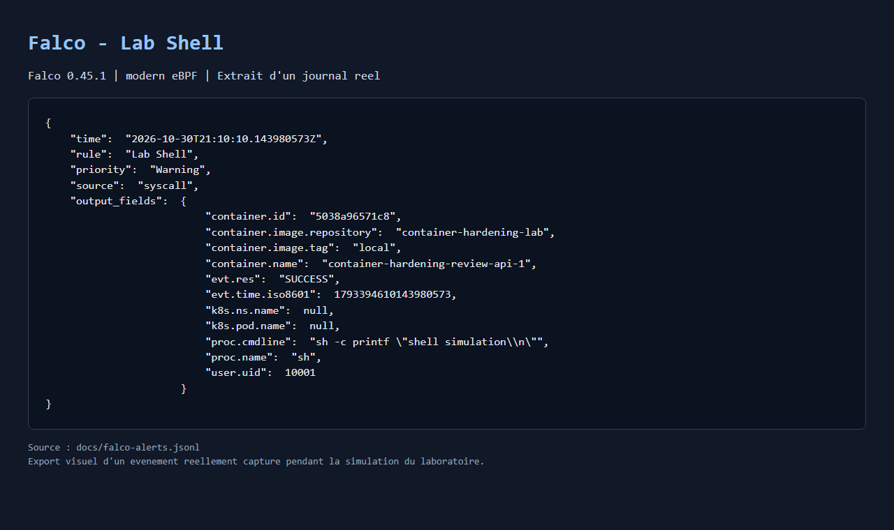
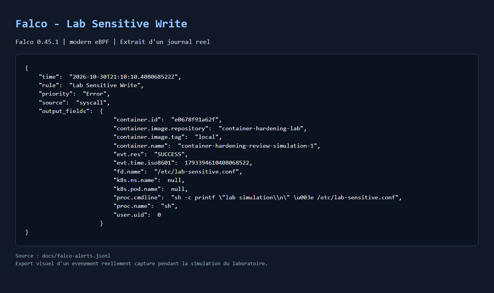

# Durcissement de conteneur & sécurité au runtime (Docker, Cosign & Falco)

[](https://github.com/mawed44/docker-security-hardening-sigstore/actions/workflows/container-security.yml)

Ce laboratoire protège une petite API Python avec une image Docker durcie, un scan **Trivy**, une signature **Cosign (Sigstore)** et une surveillance **Falco avec eBPF**. Le code utilise Python et Bash.

## Problématique

Un conteneur exécuté en root avec des privilèges inutiles et des fichiers modifiables augmente l'impact d'une compromission. Une image doit aussi provenir du signataire attendu, et son comportement doit être surveillé pendant son exécution.

## Solution apportée

L'[API Flask](main.py) expose `GET /` et `GET /health`. Les [six tests HTTP](test_main.py) vérifient les réponses JSON, les chemins inconnus (`404`) et le refus des requêtes `POST` (`405`). Gunicorn sert l'API dans Docker et écrit les journaux sur la sortie standard.

Le [Dockerfile](Dockerfile) comporte deux étapes : installation des dépendances, puis création de l'image finale. La base Python/Alpine est fixée par version et digest. Le code appartient à root, l'application utilise l'UID/GID `10001` et pip est retiré de l'image finale.

| Outil | Contrôle | Résultat en cas de problème |
| --- | --- | --- |
| **Docker Compose** | Non-root, `cap_drop: ALL`, `no-new-privileges`, racine en lecture seule | Privilèges et écritures limités |
| **Trivy** | Vulnérabilités de l'image et de ses composants | Publication bloquée si `HIGH` ou `CRITICAL` |
| **Cosign** | Signature du digest et identité du signataire | Lancement interrompu si la vérification échoue |
| **Falco** | Shell exécuté et ouverture en écriture d'un fichier factice | Alerte au runtime |

Un seul [compose.yaml](compose.yaml) définit les services. L'API démarre seule par défaut, avec un port publié sur `127.0.0.1`, des limites de ressources et un `/tmp` temporaire protégé par `noexec`, `nosuid` et `nodev`. Le profil `runtime` regroupe Falco et le conteneur de simulation.

Le [workflow GitHub Actions](.github/workflows/container-security.yml) appelle [scripts/ci.sh](scripts/ci.sh) :

- **`scan`** construit et analyse l'image lors des `pull_request` vers `main` et des `push` sur `main`. Le rapport Trivy est conservé 30 jours, même si le scan échoue.
- **`publish`** récupère cette même image par archive, sans reconstruction, après un scan réussi sur un `push` sur `main`. Il la publie dans GHCR, signe son digest avec l'identité OIDC du workflow, puis vérifie la signature.

Les actions sont fixées par SHA. Seul le job de publication reçoit les permissions d'écriture GHCR et OIDC ; aucune clé de signature manuelle n'est nécessaire. Le [script de déploiement](scripts/verify-and-run.sh) accepte uniquement le digest de l'image de ce dépôt et vérifie l'identité exacte du workflow sur `main`, avec l'émetteur GitHub Actions, avant de lancer ce même digest. Une signature valide ne garantit pas l'absence de vulnérabilités.

Les [deux règles Falco](falco_rules.local.yaml) ciblent le label `security.lab=container-hardening` :

- **`Lab Shell`** : exécution d'un shell dans un conteneur du laboratoire.
- **`Lab Sensitive Write`** : ouverture en écriture réussie de `/etc/lab-sensitive.conf`, un fichier factice.

La simulation utilise un conteneur root avec une racine inscriptible, sans réseau ni montage de fichiers de l'hôte et sans capacités Linux. L'API garde ses restrictions. Falco détecte les actions ; il ne les bloque pas. Le capteur reçoit les capacités nécessaires à eBPF et accède au socket Docker pour identifier les conteneurs ; le montage `:ro` de ce socket ne limite pas les opérations de l'API Docker.

## Résultats attendus

- API fonctionnelle, exécutée sans privilèges et avec une racine en lecture seule.
- Publication bloquée par les vulnérabilités `HIGH` ou `CRITICAL` et signature vérifiée avant déploiement.
- Écriture refusée dans l'API et alertes Falco associées aux conteneurs attendus.
- Preuves reproductibles conservées dans `docs/`.

La validation après réorganisation confirme **6 tests HTTP**, **16 contrôles de durcissement**, aucune vulnérabilité `HIGH` ou `CRITICAL` et trois alertes Falco réelles sur Docker Desktop avec le noyau WSL2 `6.6.114.1`. Les tests HTTP et de durcissement sont exécutés localement. Les simulations de régression vérifient aussi qu'une alerte du seul simulateur ne peut pas valider le shell attendu dans l'API.

Cette [exécution GitHub Actions réussie](https://github.com/mawed44/docker-security-hardening-sigstore/actions/runs/41124912445) confirme la publication et la vérification Cosign avant la réorganisation des fichiers. La nouvelle organisation devra être validée sur GitHub Actions après le prochain commit et push.

Consulter les [alertes JSON](docs/falco-alerts.jsonl), le [démarrage eBPF](docs/falco-startup.log) et les [contrôles de durcissement](docs/hardening.txt). Sur l'environnement testé, la mitigation TOCTOU optionnelle n'était pas active ; la collecte et les alertes eBPF fonctionnaient.

Ces images sont des exports visuels des journaux réels :





## Lancer le projet

Installer Docker avec le plugin Compose et utiliser des conteneurs Linux. Les exemples suivants utilisent **Bash** : Git Bash convient aux commandes Docker sous Windows. Falco nécessite un noyau Linux compatible eBPF.

Depuis la racine du dépôt, vérifier Docker :

```bash
docker info --format 'Système : {{.OSType}} ; noyau : {{.KernelVersion}}'
docker compose version
```

**Construire, démarrer et vérifier l'API**

```bash
API_PORT=18080 docker compose up --build -d --wait api
curl -i http://127.0.0.1:18080/health
bash scripts/check-hardening.sh
```

La réponse attendue est `200` avec `{"status":"ok"}`. Les 16 contrôles doivent afficher `[OK]`. `API_PORT` permet de choisir le port de l'hôte ; sans cette variable, le port est `8080`. Python s'exécute dans le conteneur et ne doit pas être installé sur Windows. Ce lancement construit une image locale sans vérifier de signature ; le déploiement signé est décrit plus bas.

**Scanner l'image**

Installer [Trivy](https://trivy.dev/docs/latest/getting-started/installation/) dans le `PATH`, puis lancer :

```bash
bash scripts/ci.sh scan
```

Le rapport est écrit dans `reports/trivy.json`, ignoré par Git. Un autre nom d'image peut être passé après `scan`. Le workflow installe automatiquement Trivy et Cosign.

**Déployer une image signée**

Installer [Cosign](https://docs.sigstore.dev/cosign/system_config/installation/) dans le `PATH`. Après un workflow réussi sur `main`, copier la référence GHCR depuis son résumé. Remplacer `<digest>` ci-dessous par ses 64 caractères hexadécimaux :

```bash
API_PORT=18080 bash scripts/verify-and-run.sh \
  'ghcr.io/mawed44/docker-security-hardening-sigstore@sha256:<digest>'
```

Le script vérifie la signature avant de télécharger et démarrer l'image. Pour un package GHCR privé, se connecter avec `docker login ghcr.io --username mawed44` et un jeton autorisé à lire les packages.

**Déclencher les alertes Falco**

Avec l'API démarrée :

```bash
API_PORT=18080 bash scripts/simulate-intrusion.sh
```

Le script démarre Falco et le conteneur de simulation, vérifie le durcissement et déclenche les événements. Il attend un shell dans l'API avec l'UID `10001` et une ouverture en écriture du fichier factice dans le bon conteneur de simulation. Il échoue si ces alertes ne sont pas reçues. Les journaux remplacent les preuves précédentes dans `docs/` ; les PNG restent les exports de la validation illustrée.

**Consulter les journaux et arrêter tous les services**

```bash
docker compose logs api
docker compose logs -f falco
# Quitter le suivi avec Ctrl+C, puis arrêter le laboratoire.
docker compose --profile runtime down
```

**Développement Python local — option Ubuntu WSL ou Linux**

Un environnement virtuel créé dans WSL s'utilise depuis Ubuntu, pas depuis Git Bash. Pour y utiliser aussi Docker, activer l'intégration Ubuntu dans Docker Desktop.

```bash
python3 -m venv .venv
source .venv/bin/activate
python3 -m pip install -r requirements.txt
python3 -m unittest -v
python3 main.py
```

Le serveur local écoute sur `127.0.0.1:8080`, avec le mode debug désactivé. Utiliser `Ctrl+C` pour l'arrêter et `deactivate` pour quitter l'environnement virtuel.

## Licence

La licence prévue est **MIT**. Le fichier `LICENSE` reste à ajouter.
